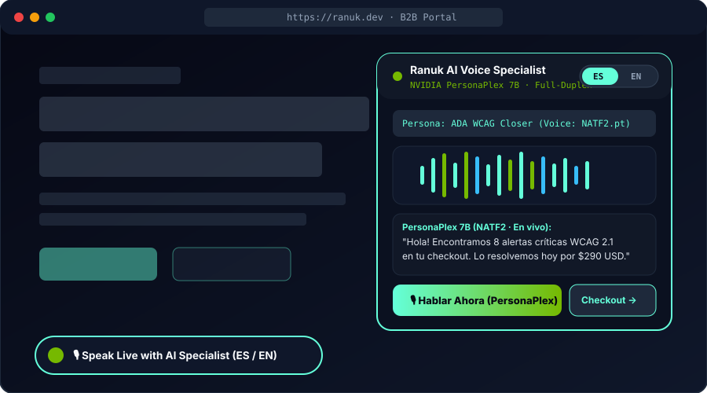

<div align="center">
  

  <br />

  [](https://huggingface.co/nvidia/personaplex-7b-v1)
  [](https://github.com/RanuK12/ranuk-voice-closer)
  [](#18-native-personaplex-voice-embeddings)
  [](LICENSE)

  <p align="center">
    <strong>Enterprise Full-Duplex B2B AI Voice Receptionist &amp; Inbound Sales Closer (English &amp; Español)</strong><br />
    Built by <a href="https://ranuk.dev"><strong>Ranuk IT Solutions (Emilio Ranucoli)</strong></a> · Powered 100% by <strong>NVIDIA PersonaPlex 7B (<code>nvidia/personaplex-7b-v1</code> / <code>moshi</code>)</strong>
  </p>
</div>

---

## Overview

**Ranuk Voice Closer (`ranuk-voice-closer`)** turns **NVIDIA PersonaPlex (`nvidia/personaplex-7b-v1`)** into a turnkey, embeddable B2B revenue engine. Unlike cascaded STT → LLM → TTS pipelines that suffer from awkward 1.5–3.0 second pauses, PersonaPlex operates as a unified **full-duplex speech-to-speech model** (`moshi` architecture: Mimi 24kHz neural audio codec + Helium 7B temporal transformer) that listens and speaks simultaneously with natural barge-in, backchanneling (`"uh-huh"`, `"claro"`), and zero external TTS APIs.

Both **English (`en`)** and **Spanish (`es`)** interactions are conditioned directly via PersonaPlex's native `--text-prompt` `<system> ... <system>` tag and its **18 pre-packaged `.pt` voice embeddings**.

<p align="center">
  
</p>

---

## Key Capabilities

- **100% Native NVIDIA PersonaPlex (`nvidia/personaplex-7b-v1`)**: Wraps both `python -m moshi.server` (real-time full-duplex binary WebSockets) and `python -m moshi.offline` (deterministic batch WAV-to-WAV evaluation) with `--cpu-offload` support for single-GPU / hybrid workstations.
- **18 Native Voice Embeddings (`NATF0..3`, `NATM0..3`, `VARF0..4`, `VARM0..4`)**: Switch instantaneously across all 18 official PersonaPlex voice prompts without external TTS dependencies.
- **Bilingual `<system> ... <system>` Role & Telemetry Conditioning (EN & ES)**: Injects live prospect telemetry—such as detected **ADA / WCAG 2.1 AA accessibility violations**, domain names, and B2B pricing—directly into PersonaPlex's `<system>` prompt in English or Español.
- **Drop-In B2B Web Widget (`widget/ranuk-voice-widget.js`)**: Zero-dependency floating voice closer with language toggle (`ES` / `EN`), live waveform visualizer, voice embedding selector, and 1-click handoff to Stripe / Cal.com checkout.

<p align="center">
  
</p>

---

## 18 Native PersonaPlex Voice Embeddings

| Category | Female Voice Embeddings | Male Voice Embeddings | Recommended B2B Use Case |
| :--- | :--- | :--- | :--- |
| **Natural (NAT)** | `NATF0.pt`, `NATF1.pt`, `NATF2.pt`, `NATF3.pt` | `NATM0.pt`, `NATM1.pt`, `NATM2.pt`, `NATM3.pt` | **Primary B2B Sales Closer, ADA/WCAG Compliance Advisor, Enterprise SDR** (`NATF2.pt` & `NATM1.pt` default) |
| **Variety (VAR)** | `VARF0.pt`, `VARF1.pt`, `VARF2.pt`, `VARF3.pt`, `VARF4.pt` | `VARM0.pt`, `VARM1.pt`, `VARM2.pt`, `VARM3.pt`, `VARM4.pt` | **High-Energy Outbound Campaigns, Concierge Desk, Specialized Verticals** |

---

## Pre-Built B2B Closer Personas (`ranuk_voice_closer/personas.py`)

1. **`ada_wcag_specialist` (EN & ES · Default Voice: `NATF2.pt`)**
   - Walks website owners through live WCAG 2.1 AA compliance gaps (missing `alt` attributes, low contrast ratios, keyboard focus traps, unlabeled ARIA controls) and guides them to the **$290 USD turnkey remediation checkout** at [audit.ranuk.dev](https://audit.ranuk.dev).
2. **`ranuk_enterprise_sdr` (EN & ES · Default Voice: `NATM1.pt`)**
   - Qualifies inbound enterprise leads for custom NVIDIA PersonaPlex deployments, autonomous AI workflows, and full-stack ML platforms with **Emilio Ranucoli** at [ranuk.dev](https://ranuk.dev/#contact).
3. **`medical_receptionist` (EN & ES · Default Voice: `NATF0.pt`)**
   - Clinical & dental intake receptionist verifying insurance coverage and booking urgent vs. routine appointments.
4. **`banking_specialist` (EN & ES · Default Voice: `NATM3.pt`)**
   - Commercial banking & fintech specialist assisting corporate treasury clients (4.85% APY accounts, wire limits, card security).

---

## Quickstart

### 1. Install Prerequisites & Package

```bash
# Install libopus for Moshi 24kHz audio codec support
brew install opus  # macOS
# sudo apt-get install libopus-dev  # Ubuntu/Debian

git clone https://github.com/RanuK12/ranuk-voice-closer.git
cd ranuk-voice-closer
pip install -e ".[dev]"
```

### 2. Authenticate with Hugging Face for `nvidia/personaplex-7b-v1`

Accept the model license at [huggingface.co/nvidia/personaplex-7b-v1](https://huggingface.co/nvidia/personaplex-7b-v1) and export your token:

```bash
export HF_TOKEN="hf_your_token_here"
```

### 3. Launch the Ranuk Voice Closer Server

```bash
ranuk-voice-closer --host 0.0.0.0 --port 8999
```

Or launch the underlying `moshi.server` directly with `--cpu-offload`:

```bash
SSL_DIR=$(mktemp -d)
python -m moshi.server --ssl "$SSL_DIR" --cpu-offload
```

### 4. Condition PersonaPlex in Español or English via Python API

```python
from ranuk_voice_closer import PersonaPlexVoiceEngine

engine = PersonaPlexVoiceEngine()

# Spanish ADA/WCAG Closer conditioned with <system> prompt & NATF2.pt voice embedding
response = engine.respond(
    persona_id="ada_wcag_specialist",
    language="es",
    user_utterance="¿Cuál es el precio para corregir las alertas WCAG de mi tienda?",
    voice_override="NATF2.pt",
    dynamic_context={
        "domain": "mitienda.com",
        "wcag_violations": 14,
        "critical_issues": ["contraste insuficiente", "botones sin aria-label"],
        "price_usd": 290,
    },
)

print("Voice Prompt:", response.voice_prompt)       # NATF2.pt
print("System Prompt:", response.text_prompt)       # <system> Trabajas para Ranuk IT Solutions... <system>
print("Moshi Command:", " ".join(response.moshi_cli_command))
print("Transcript:", response.transcript)
```

### 5. Embed the Voice Widget on Any Website (`1 line of HTML`)

```html
<script src="https://ranuk.dev/assets/ranuk-voice-widget.js" defer></script>
```

---

## Running the Test Suite

```bash
pytest -v
```

---

## Commercial Deployment & Custom Engineering

Need a dedicated full-duplex **NVIDIA PersonaPlex 7B** voice agent integrated with your CRM, WhatsApp/SIP telephony trunk, or Stripe checkout?

- **Turnkey ADA/WCAG Remediation ($290 USD)**: [https://audit.ranuk.dev](https://audit.ranuk.dev)
- **Ranuk IT Solutions Portal**: [https://ranuk.dev](https://ranuk.dev)
- **Author**: Emilio Ranucoli ([GitHub @RanuK12](https://github.com/RanuK12) · [LinkedIn](https://linkedin.com/in/emilio-ranucoli))
